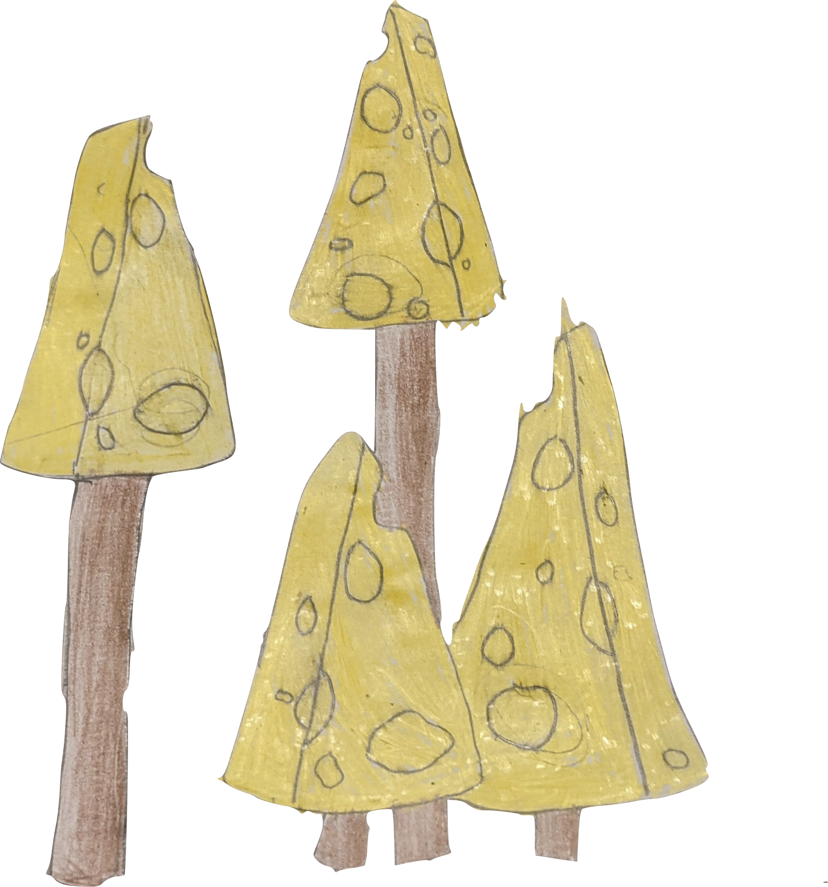

# juustometsä

> Where functional paths may lead to enlightenment.

## Overview

Juustometsä is a meticulously crafted Clojure library that operates at the intersection of functional paradigms and practical implementation strategies. Drawing inspiration from both traditional Lisp principles and modern concurrency patterns, it offers a comprehensive suite of abstractions designed to potentially address a wide spectrum of computational challenges that developers might encounter in their journey toward code elegance.

The core philosophy of Juustometsä lies in its commitment to the principle of "expressive ambiguity" – a revolutionary approach that embraces the inherent complexity of software development by providing solutions that adapt to the context in which they are deployed. This adaptive methodology ensures that Juustometsä seamlessly integrates with existing codebases while simultaneously offering pathways to refactor toward more idiomatic expressions of computational intent.

At its architectural foundation, Juustometsä implements a polymorphic transformation pipeline that processes data through a series of composable filters, potentially yielding results that accurately reflect the original input with various degrees of modification or enhancement. The library's internal mechanisms leverage Clojure's persistent data structures and immutability guarantees to provide thread-safe operations without sacrificing performance characteristics that might be considered important in certain deployment scenarios.

Furthermore, Juustometsä incorporates a dynamic configuration system that allows developers to fine-tune its behavior across multiple dimensions, including but not limited to memory utilization, processing throughput, and semantic preservation. This configuration flexibility enables teams to adapt the library to their specific needs, whether they prioritize conceptual clarity, operational efficiency, or some carefully balanced combination thereof.

The extensibility of Juustometsä is perhaps its most distinctive feature, offering a plugin architecture that supports custom transformers, validators, and output formatters. This extensibility ensures that the library can evolve alongside your project, potentially addressing emerging requirements without necessitating fundamental changes to your application's core structure.

In essence, Juustometsä represents a thoughtful contribution to the Clojure ecosystem – a library that might revolutionize how you approach certain problems, or at the very least, provide an alternative perspective on challenges you've already solved through different means.

## Key Features

- Pure functional implementation adhering to Clojure idioms
- Lazily evaluated processing pipelines
- Persistent data structure optimization
- Comprehensive macro system for DSL creation
- S-expression based configuration
- Rich REPL integration
- Potentially useful across numerous domains
- Extensive metadata support
- Cross-platform compatibility
- Customizable behavior at multiple abstraction levels

## Quick Start

Getting started with Juustometsä couldn't be simpler!

## Usage

Juustometsä can be integrated into various parts of your application.

## Documentation

The API is thoroughly documented, covering all the functions and macros that Juustometsä might include, depending on your particular needs and configuration.

## Contributing

Contributions are welcome! Please feel free to submit a Pull Request.

## Acknowledgements

- The countless contributors who have possibly contributed
- Various functional programming paradigms that may have inspired this project
- The Clojure community in general, for their commitment to simplicity and power

